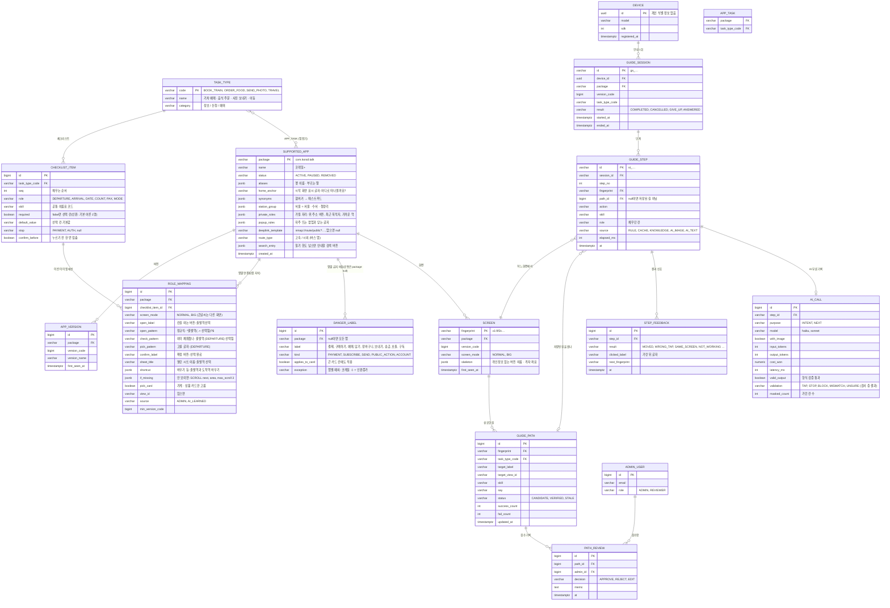

# 5.1.2 파트 사이 약속 v0.2 · ERD v1 (김우석)

> 원본은 이 파일. 바뀌면 PR로 고치고 워크스페이스 5.1.2에 링크. 해원님 의견(11/25)대로 **확정본이 아니라 러프한 초안**이며 2회차 멘토링 뒤 v1로 다듬음.

> 상태: **v0.2 (11/27)**. v0.1(11/25)에 11/26 ~ 27 실제 폰 시험(코레일+ · 배민) 결과 7가지를 반영(아래 표, 업무 5.1.3). 파일 이름은 링크가 깨지지 않게 그대로 둠.
> v0.1: v0(11/24)에 실제 폰 시험(11/25 새벽, 앱 9개) 결과를 반영. 업무 번호가 4.1.1 → 5.1.3 → **5.1.2**로 바뀜.
> 근거: 5.1.1 기술 메모(①~④), 시나리오 1 · 2 단계표, 11/25 실제 폰 시험 결과, 시제품 코드 senior-guide-backend PR #2(`prototype/guide-night-1125/`).
> 약속을 바꿀 때는 플랫폼 파트장(김우석)이 승인하고 앱 · AI 파트장에게 알림. **⚠ = 다른 파트 확인이 필요한 줄**(9절에 모음).

### v0.1 → v0.2 바뀐 것 (11/27)
| | 어디 | 바뀐 것 | 왜 (실제 폰 시험) |
|---|---|---|---|
| ⓐ | 검사 층 · AI 답(9절 A3) | AI는 좌표 대신 **후보 번호 `pick`**(= ① `elements[].idx`)만 줌. 서버가 그 칸의 `bounds` · 글자로 바꿔 검사 | 좌표를 지어낼 길이 없어짐. 번호로 고르는 시제품 판단기(`brain.py`)가 저장 화면 24개 중 22개 |
| ⓑ | ① `elements[]` | **`selected`**(지금 고른 탭 · 칩) 추가. 앱이 모르면 `null` | 배민 「돈까스 · 회」 잘못 누름을 화면 글자만으로는 못 알아챔. 시험 앱에서 실제 폰으로 읽힘 확인 |
| ⓒ | 3-1 지문 | 숫자 전부 `#` → **시계 · 남은 시간 · 금액 모양만 지우고 날짜 · 인원 숫자는 남김** | 코레일 「가는날」 27일 → 28일로 바꿔도 지문이 같아 옛 안내 반복(11/25 밤, 11/27) |
| ⓓ | ① `stuck` | `true/false` → **`NONE` · `USER` · `TIMEOUT`**. 같은 화면 45초(설정값)면 앱이 `TIMEOUT`으로 ①을 다시 보냄 | 화면이 안 바뀌면 서버가 다시 판단할 기회가 없음. 시제품은 45초 거절로 풀었음 |
| ⓔ | ⓪ `input` | 선택 칸 **`stt{engine, ms}`**(소리는 안 보냄) | 「받아쓰기는 폰 내장 먼저, 부족하면 서버」(11/27 결정)를 엔진별 숫자로 판단 |
| ⓕ | 판단 규칙(API 그대로) | **다른 화면에 갔다 돌아온 화면은 옛 판단을 재사용하지 않고 다시 판단** | 코레일에서 다녀온 사이 값이 바뀌었는데 옛 안내가 뜸(11/27) |
| ⓖ | ⓪ 말 해석 규칙(API 그대로) | 「오늘 날짜」는 **서버가 KST로 요청마다** AI에 넣음 | 시제품 프롬프트에 날짜가 박혀 「내일」이 지난 날짜(11/27) |

### v0 → v0.1 바뀐 것
| 어디 | 바뀐 것 | 왜 (실제 폰 시험) |
|---|---|---|
| 새 API | `POST /v1/guide/intent` 말 해석 | 말 해석(세션당 1번)과 다음 버튼(화면마다)은 부르는 횟수 · 답 모양 · 채점이 다름 |
| ① 요청 | `clickedLabel` · `clickedViewId` 추가 | 화면만으로는 잘못 누름을 못 알아챔(선택된 탭 정보 없음) |
| ① 지문 | 글자 해시 → **누름 칸 구조 겹침 ≥ 0.9**로 같은 화면 판정 | 가만히 둔 배민 홈도 글자 지문이 30초에 6번 모두 다름 |
| ② 응답 | target = 칸 번호 + 글자 + 좌표 + viewId + **화면 지문**, 앱은 겹침 < 0.9면 버림 | 늦은 응답이 쿠팡 상세에 떨어지면 그 자리가 「구매하기」 |
| ② 응답 | action `PICK_BY_USER` · `OPEN_DEEPLINK` 추가, `reason`으로 멈춤 · 기다림 이유 | 권한 · 확인 창은 어르신이 고름, 지도 · 유튜브는 링크로 결과 화면이 바로 열림 |
| ② 응답 | SCROLL 방향 `next/prev/left/right` = 「더 보고 싶은 쪽」 | 모델마다 up/down 뜻이 반대라 실제로 반대로 밂 |
| ② 멈춤 | 금지 버튼 표(`DANGER_LABEL`) + 화면 아래 돈 버튼 규칙 | AI가 「장바구니 담기」를 권함(Sonnet 2번), 큰 「예매」 버튼 검사 구멍 |
| 새 절 | 3-2 AI 답 검사 층 | 계획서 「AI 하네스」의 실제 방식 |
| ③ 결과 | `WRONG_TAP` · `ANSWERED` 추가 | 잘못 누름 복구, 정보형 목표(「몇 시에 있어?」)는 성공 조건이 다름 |
| ERD | 앱 지식 칸 · 금지 버튼 표 · 화면 모드 · 승객 종류 | 큰글씨 모드는 완전히 다른 화면(겹침 0.0), 코레일 「경로(65세 이상)」 인원 |
| 저장 | Redis 안내 세션 칸 확정 | 밀어서 확인 글자가 사라지면 같은 칸을 다시 고르려 함 |
| 가리기 | **1차 = 폰 안**, 서버 = 2차 검사 | 접근성 글자로 가리면 시트 뒤 주소가 샘(실제 2번) |

---

## 0. 한눈에 보기

```
[폰 앱]                          [서버]                                        [AI 파트]
 말 · 버튼 ──⓪ 말 해석────▶  입구(게이트웨이 · 인증)
                               └▶ 판단 서비스 ─────────────────────────────▶ 말 해석 모델
 앱 열기 ◀── 앱 · 링크 · 되묻기 ◀┘ (칸 이름 정규화 · 되묻기 규칙)
 화면 읽기 ──① 화면 뼈대──▶  판단 서비스: 규칙 → 저장된 길 → 앱 지식 표 ─ 다 없으면 ─▶ 판단 API(사진 + 작은 모델)
                                           └ AI 답은 검사 층을 거쳐야 나감 ◀──────────┘
 표시 · 소리 ◀──② 판단 응답──┘
 누른 칸 · '안 돼요' ──③ 결과 신호──▶ 판단 서비스 ──④ 이벤트(비동기)──▶ 길 저장 · 실패 모으기 · 기록 · 관리 웹 검수
```

- ⓪①②③은 **폰 ↔ 서버**(HTTP · JSON). ④는 **서버 안쪽**(메시지 큐).
- ②는 바로 답해야 해서 동기, 저장 · 집계 · 검수는 **이벤트로 넘겨 비동기**(멘토 요구: 논블로킹). AI 호출도 스레드를 잡지 않게 논블로킹으로 부름.
- 판단 순서(시제품 시험: 21화면 중 AI가 필요한 화면 1개): **① 규칙**(권한 · 동의 · 광고 · 결과 없음 · 돈 버튼 · 팝업) → **② 저장된 길** → **③ 앱 지식 표** → **④ AI** → **검사 층**.

---

## 1. 공통 규칙

### 1-1. 응답 형식 (모든 API 같음)
```json
// 성공
{ "ok": true,  "data": { ... }, "traceId": "c0a8…" }
// 실패
{ "ok": false, "error": { "code": "GUIDE_APP_NOT_SUPPORTED", "message": "아직 도와 드릴 수 없는 앱이에요" }, "traceId": "c0a8…" }
```
- `traceId`: 요청 하나를 게이트웨이 → 판단 → AI → 로그까지 따라가는 번호. 앱 로그에도 같이 남김.
- `message`는 **어르신께 그대로 보여 줘도 되는 말**로 씀. 개발용 설명은 로그에만.

### 1-2. 오류 코드 (앞머리 = 담당 영역)
| 코드 | HTTP | 뜻 | 앱이 할 일 |
|---|---|---|---|
| `AUTH_TOKEN_EXPIRED` | 401 | 기기 토큰 만료 | 토큰 다시 받고 1번 재시도 |
| `AUTH_FORBIDDEN` | 403 | 권한 없음(관리자 API 등) | 표시 안 함 |
| `RATE_LIMITED` | 429 | 너무 자주 보냄 | `retryAfterMs` 뒤 재시도 |
| `GUIDE_APP_NOT_SUPPORTED` | 200(ok=false) | 지원 앱 목록에 없음 | "아직 이 앱은 못 도와 드려요" |
| `GUIDE_SCREEN_UNREADABLE` | 200(ok=false) | 글자가 거의 없음 | 사진 판단 동의했으면 사진으로 다시 요청 |
| `GUIDE_PRIVATE_LEAK` | 200(ok=false) | **새** 들어온 화면에 가려지지 않은 개인정보 글자가 보임 → AI로 안 보냄 | 폰에서 다시 가려서 1번 재시도, 또 걸리면 사진 없이 |
| `AI_TIMEOUT` | 504 | AI가 시간 안에 답 못 함 | "잠깐만요" 유지 후 1번 재시도 |
| `AI_BAD_OUTPUT` | 502 | AI 답이 약속 형식이 아님(하네스 검증 실패) | 1과 같음 |
| `INTERNAL_ERROR` | 500 | 그 밖 | "다시 해 볼게요" |

### 1-3. 이름 규칙
- JSON 키는 `camelCase`, 이벤트 이름은 `소문자.점.구분.과거형`(`guide.step.decided`), DB는 `snake_case`.
- 시간은 ISO-8601 + 시간대(`2026-11-25T14:10:00+09:00`). 돈은 원 단위 정수.
- API 주소 앞에 버전: `/v1/...`. 깨지는 변경은 `/v2`.
- **칸 이름(role)은 ⓪ slots · 체크리스트 · 앱 지식 표 · 정답셋에서 같은 이름**: `DEPARTURE · ARRIVAL · DATE · COUNT · PAX · MODE · RECIPIENT · CATEGORY · BRAND · STORE · ITEM` (6절 아래 표)

### 1-4. 브랜치 · 커밋 · PR (팀 하네스 AGENTS.md)
- 브랜치 `종류/WBS번호-영문-설명`: `feat/5.2.1-guide-next-api`
- 커밋 `[Add]_5.2.1/GuideNextApi` + 다음 줄 `- 바뀐 내용` (머리말 Add · Fix · Refactor · Docs)
- PR 제목 `[5.2.1] 한 줄 설명`, 승인 1명 + CI 통과, squash. 본문 `Closes #이슈번호`(GitHub 이슈를 손으로 만들지 워크스페이스에서 만들지 **확인 중**)

---

## 2. ⓪ 말 해석 (앱 → 서버) `POST /v1/guide/intent` (새로 추가)

어르신의 말 · 「자주 하는 일」 버튼 · 글자 입력을 받아 **업무 종류와 칸**을 채움. 세션 시작 때 1번, 되묻기 답마다 1번.

요청
```json
{
  "sessionId": null,                                  // 첫 요청은 null → 서버가 만들어 줌. 되묻기 답은 같은 sessionId
  "input": { "type": "VOICE", "text": "서울역에서 대전 가는 기차표 모레 두 장",   // VOICE | TEXT | BUTTON(버튼이면 text = 업무 코드)
             "stt": { "engine": "samsung", "ms": 1200 } },      // v0.2 선택 칸: 받아쓴 엔진 · 걸린 시간(소리는 안 보냄)
  "installedApps": ["com.korail.talk", "com.ebcard.bustago", "com.nhn.android.nmap"],   // 지원 앱 중 깔린 것만
  "device": { "model": "SM-G996N", "sdk": 34, "fontScale": 1.3, "bigMode": false }
}
```
응답 `data`
```json
{
  "sessionId": "gs_01JD…",
  "taskType": "BOOK_TRAIN",                            // 업무 종류(6절 아래)
  "slots": { "DEPARTURE": "서울", "ARRIVAL": "대전", "DATE": "2026-11-27", "COUNT": 2, "MODE": "TRAIN" },
  "missing": [],                                       // 비면 다음으로, 있으면 action = ASK
  "action": "OPEN_APP",                                // ASK | OPEN_APP | OPEN_DEEPLINK | UNSUPPORTED
  "app": { "package": "com.korail.talk", "deeplink": null, "fallback": "OPEN_APP" },
  "say": "서울에서 대전 가는 11월 27일 기차표 2장을 찾아볼게요."
}
```
- **오늘 날짜(v0.2)**: 「내일 · 모레」를 풀 수 있게 서버가 요청마다 KST 오늘 날짜 · 요일을 AI에 넣음. 프롬프트에 날짜를 박지 않음. 시험 재현용으로 날짜 고정 설정을 둠.
- `input.stt`(v0.2): 엔진별 말 해석 성공률을 모아 서버 받아쓰기로 바꿀지 정하는 근거. 없어도 동작은 같음.
- 역할 나눔: **AI는 정보 뽑기(taskType · slots · missing)만.** 무엇을 되물을지 · 앱 고르기 · `say` 문장은 Guide 서비스 규칙과 **템플릿**으로 만듦(AI가 지은 문장을 그대로 어르신께 말하지 않음).
- **칸 이름 정규화 층**(Guide): 「서울역」 → 「서울」, 「모레」 → 날짜, 「두 장」 → COUNT 2, 「햄버거」 → 앱별 표기(배민 「패스트푸드」, 쿠팡이츠 「버거」). 시제품 `normalize.py`.
- 인원은 **선택 칸**(말 안 하면 어른 1명). 시험에서 「두 장」이 빠져 1명으로 조회할 뻔함 → 정답셋에 인원 문장 꼭 넣기.
- `PAX`(승객 종류: 어른 · 경로 · 어린이 …)는 선택 칸. 코레일 「경로(65세 이상)」 할인을 놓치지 않게 → 되묻기 할지는 결정 대기(12절).
- 이동형(`TRAVEL`, 「부산 가고 싶어」): 수단이 안 정해지면 `MODE`를 되묻거나 지도 앱 링크로 수단 비교부터.
- ⚠ 이 응답 모양이 4.6 정답셋의 정답 형식. AI 파트 확인 필요(9절 A1).

---

## 3. ① 화면 뼈대 (앱 → 서버) `POST /v1/guide/next`

폰이 지금 화면을 읽은 결과. **개인정보는 폰에서 가린 뒤** 보냄(3-3).

```json
{
  "sessionId": "gs_01JD…",
  "app": { "package": "com.korail.talk", "versionName": "6.3.1", "versionCode": 631 },
  "device": { "model": "SM-G996N", "sdk": 34, "fontScale": 1.3, "bigMode": false, "screenW": 1080, "screenH": 2400 },
  "screen": {
    "fingerprint": "v1:9f2c…",          // 저장된 길 찾기용 해시(3-1)
    "activity": "com.korail.talk.main.MainActivity",   // 있으면
    "elements": [
      { "idx": 1, "text": "열차 조회", "role": "BUTTON", "bounds": [541, 967, 1024, 1102], "viewId": "com.korail.talk:id/btn_search", "selected": false },
      { "idx": 2, "text": "",          "role": "BUTTON", "bounds": [45, 790, 1035, 1079] },   // 글자 없는 칸도 보냄(사진 판단 필요 여부 계산)
      { "idx": 3, "text": "[주소]",    "role": "TEXT",   "bounds": [40, 60, 1040, 330] }
    ],
    "masked": { "NAME": 0, "PHONE": 0, "ADDRESS": 1, "CARD": 0 },   // 몇 개 가렸는지(기록용)
    "screenshot": null                  // 서버가 needScreenshot을 준 뒤에만, 폰 안에서 가린 JPEG(base64)
  },
  "lastStep": { "stepId": "st_…", "clickedLabel": "돈까스·회", "clickedViewId": null },   // 새: 직전에 실제로 누른 칸(접근성 클릭 이벤트)
  "stuck": "NONE"                       // v0.2: NONE | USER('안 돼요'를 누름) | TIMEOUT(같은 화면 45초 그대로)
}
```
- `role`: `BUTTON` · `INPUT` · `TEXT` · `IMAGE`
- `bounds`: 폰 화면 좌표 `[왼, 위, 오른, 아래]`. 판단 · 표시 · 같은 화면 판정에 씀. 저장된 길의 키에는 안 씀.
- **`clickedLabel`**: 앱이 접근성 클릭 이벤트로 받은 「실제 누른 칸 글자」. 서버가 직전 안내 target과 다르면 `WRONG_TAP`으로 보고 복구 안내. ⚠ 앱 파트 확인(9절 P1).
- **`selected`**(v0.2): 접근성 `isSelected()`. 글자 칸부터 누를 칸까지(최대 5칸 위) 중 하나라도 선택이면 `true`. 앱이 알 수 없으면 `null`(서버는 「모름」으로 보고 v0.1처럼 판단).
- **`stuck: TIMEOUT`**(v0.2): 같은 화면이 20초면 앱이 같은 안내를 크게 다시 띄우고, 45초면 ①을 `TIMEOUT`으로 다시 보냄 → 서버는 직전 안내를 「안 되는 안내」로 기록하고 다시 판단. 20초 · 45초는 설정값.
- 화면 기록(history)은 앱이 보내지 않음. **서버가 Redis 세션에 가지고 있음**(7-2).
- **다시 판단 규칙**(v0.2): 같은 화면에 머무는 동안만 직전 판단을 재사용. 다른 화면에 갔다가 같은 지문으로 돌아오면 재사용하지 않고 다시 판단(「저장된 길」 캐시는 그대로 씀).
- 서버가 사진 판단이 필요하다고 보는 경우(`needScreenshot: true`): 누를 수 있는 칸 중 글자 없는 칸 비율이 높음(코레일 열차 목록은 글자 0개) · 같은 화면이 반복됨 · 규칙 · 앱 지식이 다 없음.

### 3-1. 화면 지문 · 같은 화면 판정 v1 (앱 · 서버 같은 함수)
두 가지를 따로 씀.
1. **`fingerprint`(저장된 길 찾기 키)**: `package` + `versionCode` 큰 번호 + `activity` + BUTTON · INPUT 칸의 `viewId`와 글자(**v0.2: 시계 `12:34` · 남은 시간 · 금액 모양만 `#`, 날짜 · 인원 숫자는 남김**, 긴 칸도 「앞 이름 + 날짜 · 인원 값」은 남김, 광고 · 이벤트 글자 빼기, 가린 글자 → `[NAME]`) 정렬 → SHA-256 앞 16자, `v1:` 붙임.
2. **같은 화면 판정(`layoutMatch`)**: 누를 수 있는 칸들의 좌표를 **40px 격자로 반올림한 집합의 겹침 비율(Jaccard)**. **0.9 이상 = 같은 화면.**
   - 실측: 같은 배민 홈 다른 시각 0.97 / 배민 홈 vs 패스트푸드 0.14 / 쿠팡 홈 vs 상세 0.0 / 코레일 역 고르기 전후 0.88
   - 쓰는 곳: 앱이 ② 응답을 표시하기 직전(늦은 응답 버리기), 서버가 「같은 화면 반복」 셀 때
- 화면 모드가 다르면 다른 화면: 코레일 큰글씨 모드는 일반 모드와 겹침 0.0 → `bigMode`를 키에 넣고 앱 지식도 모드별로.
- ⚠ 앱(Kotlin) · 서버(Java)가 같은 값을 내는지 시험 화면 10개로 맞추기(9절 P2). 시험 화면 후보: 배민 패스트푸드(타임세일 시계) · 쿠팡이츠 홈(회전 문구) · 코레일 큰글씨.

### 3-2. AI 답 검사 층 (계획서 「AI 하네스」, 새로 추가)
AI 답은 그대로 내보내지 않고 Guide 서비스가 한 번 더 봄. 시제품 `validate2.py`, 시험 14/14.
1. JSON 형식 · 필수 키 검사 → 실패면 `AI_BAD_OUTPUT`
2. AI가 말한 이름에 금지 단어 → `STOP`
3. **AI가 고른 후보 번호 `pick`의 칸**(v0.2, 좌표 대신)을 찾고, 그 칸의 **진짜 글자**(칸 안 다른 버튼 글자는 뺌)로 금지 버튼 표 검사 → 걸리면 막음. AI가 「왼쪽 큰 버튼」처럼 딴 이름을 대도 칸 글자 「간편 예매」로 막힘(11/25 실제 폰 확인)
4. 작은 버튼에 금액 · 글자 없는 작은 버튼 → 막음
5. AI가 말한 글자 ≠ 그 자리 칸 글자 → 다시 판단(숨은 팝업 의심). 단 「닫기 · X」는 스크린숏 기준 허용
6. 통과하면 **검사한 그 칸을 target으로** 내보냄(검사한 칸 = 표시할 칸)
- 결과는 `AI_CALL.validation`에 남김(발표 숫자: 막은 횟수 · 이유).

### 3-3. 개인정보 가리기: 역할 나눔 (11/25 정함)
| 누가 | 무엇 |
|---|---|
| **앱(1차, 필수)** | 서버로 보내기 **전에** 폰 안에서: 글자 목록의 주소 · 전화 · 이름 · 카드번호 패턴을 `[주소]` 등으로 바꿈 / 스크린숏은 ML Kit 글자 인식(오프라인 · 한글)으로 같은 패턴 블러 + **상태 표시줄** + 앱별 가릴 자리(`private_roles`) 블러 |
| **서버(2차)** | 앱 지식 표의 `private_roles`(배민 위 주소 버튼, 쿠팡이츠 배달지, 네이버지도 최근 목적지, 코레일 「가까운 역」 등)를 앱에 내려 줌 / 들어온 글자에 개인정보 패턴이 또 보이면 **AI로 안 보내고 `GUIDE_PRIVATE_LEAK`** |
- 이유: 접근성 글자에는 팝업 · 시트 뒤로 비친 글자가 없음 → 서버 · 글자 기반으로는 반드시 샘(11/25 실제 2번).
- 못 가리는 것: 가게 지점 이름(「○○점」)처럼 AI가 골라야 하는 글자는 대략적인 위치를 드러냄 → 동의 문구에 적을지 결정 대기(12절).
- ⚠ 앱 파트 확인(9절 P3).

---

## 4. ② 판단 응답 (서버 → 앱)

```json
{
  "ok": true,
  "data": {
    "sessionId": "gs_01JD…",
    "stepId": "st_01JD…",
    "action": "TAP",
    "target": {
      "idx": 1, "label": "열차 조회", "bounds": [541, 967, 1024, 1102],
      "viewId": "com.korail.talk:id/btn_search",
      "fingerprint": "v1:9f2c…"         // 이 판단을 한 화면. 앱은 지금 화면과 layoutMatch < 0.9면 표시하지 않고 다시 요청
    },
    "say": "아래 '열차 조회'를 눌러 주세요",
    "skill": "SEARCH",
    "typeText": null,
    "scroll": null,                      // { "dir": "next", "area": [0, 700, 1080, 1900] }
    "deeplink": null,                    // OPEN_DEEPLINK일 때 { "url": "nmap://route/public?…", "fallback": "OPEN_APP" }
    "reason": null,                      // STOP · WAIT · ASK · PICK_BY_USER의 이유(아래 표)
    "source": "KNOWLEDGE",               // RULE | CACHE | KNOWLEDGE | AI_IMAGE | AI_TEXT
    "needScreenshot": false,
    "elapsedMs": 38
  }
}
```

| action | 뜻 | 앱이 할 일 |
|---|---|---|
| `TAP` | 이걸 누르세요 | 동그라미 + 말풍선 + 소리. **카드 · 버튼은 target 칸과 그 옆 배지를 가리지 않게** 놓기 |
| `TYPE` | 여기에 글자 | 입력칸 표시, `typeText` 보여 주기(대신 치진 않음). 키보드 마이크로 말하기 안내 가능 |
| `SCROLL` | 밀어 보세요 | `dir`: **`next`(아래 · 다음 내용) · `prev` · `left` · `right`** = 「더 보고 싶은 쪽」, 화살표 |
| `WAIT` | 기다리기 | 표시 없이 다음 화면 기다림 (`reason`: `LOADING` · `AD_PLAYING`) |
| `ASK` | 되묻기 | `say`를 질문으로 (`reason`: `MISSING_SLOT` · `NO_RESULT`) |
| `PICK_BY_USER` | **새** 어르신이 직접 고름 | 설명만, 표시 안 함 (`reason`: `PERMISSION` · `CONSENT` · `CONFIRM_DIALOG` · `SEAT` · `PHOTO`) |
| `OPEN_DEEPLINK` | **새** 링크로 결과 화면 열기 | `deeplink.url` 열기, 실패면 `fallback` |
| `STOP` | 사람이 직접 | `reason`: `PAYMENT` · `AUTH`(로그인 · 인증번호) · `IRREVERSIBLE_SEND`. 결제 · 인증번호 · 비밀번호는 절대 묻지 않음 |
| `DONE` | 끝 | 끝 알림 + 내 단축 저장 물어보기. 정보형 목표면 `say`가 답(「05:13 KTX가 제일 빨라요」) |
| `GIVE_UP` | '안 돼요' 2번 | "가족에게 물어보세요" **말만**(연결 기능 없음, 11/24 결정) |

**멈춤 규칙 (서버가 최종 확인, AI 답보다 우선)**
- **금지 버튼 표 `DANGER_LABEL`**(7절)의 글자가 target 칸 글자에 있으면 `STOP`. 큰 칸(가게 · 상품 카드)도 「예매 · 보내기 · 송금 · 호출 · 충전 · 결제」 같은 행동 단어는 막음(11/25 검사 구멍 고침).
- **화면 아래 25% 안의 짧은 「구매하기 · 결제하기 · 주문하기 · 예매하기」** 버튼이 보이면 그 화면은 `STOP(PAYMENT)`. 위쪽 쿠폰 배너 「할인 받고 주문하기」는 제외.
  - v0에서 바뀜: v0은 「결제 단어 + 금액」만 멈췄음(배민 「알뜰배달 주문하기」는 결제 전 단계). v0.1은 **주문 확정 버튼 앞에서 멈춤**으로 더 보수적으로(**11/25 김우석 결정**). 시나리오 2 단계표에 반영 요청
- `IRREVERSIBLE_SEND`(카톡 「전송」 등): 체크리스트에 `confirm_before: true`인 단계만 멈춤(결정 대기).
- 글자 없는 큰 칸(코레일 열차 줄)은 사진 판단으로 안내만, 다음 화면에서 금지 버튼이 보이면 멈춤(결정 대기).

---

## 5. ③ 결과 신호 (앱 → 서버) `POST /v1/guide/feedback`

```json
{ "sessionId": "gs_…", "stepId": "st_…", "result": "MOVED", "clickedLabel": "열차 조회", "nextFingerprint": "v1:7a1b…", "at": "2026-11-25T14:12:03+09:00" }
```
| result | 언제 |
|---|---|
| `MOVED` | 안내한 곳을 누르고 화면이 바뀜(성공 1회) |
| `WRONG_TAP` | **새** 다른 칸을 누름(`clickedLabel` ≠ target) → 서버가 그 칸을 「다시 할 칸」으로 |
| `SAME_SCREEN` | 눌렀는데 화면이 그대로 |
| `NOT_WORKING` | 어르신이 '안 돼요' |
| `LEFT_APP` | 다른 앱으로 나감 · 전화 옴 |
| `CANCELLED` | 그만하기 |
| `ANSWERED` | **새** 정보형 목표에 답을 받음(「몇 시 기차 있어?」) |
| `COMPLETED` | 세션 끝(DONE까지 감) |

- 서버는 바로 `202 Accepted`만 주고 이벤트로 넘김(앱이 기다리지 않음).
- 잘못 누름은 ③ 또는 다음 ①의 `lastStep.clickedLabel` 둘 중 먼저 온 것으로 처리(중복은 stepId로 막음).

---

## 6. ④ 이벤트 형식 (서버 안쪽, 비동기)

공통 봉투:
```json
{
  "eventId": "ev_01JD…", "type": "guide.step.decided", "version": 1,
  "occurredAt": "2026-11-25T14:12:01+09:00", "traceId": "c0a8…",
  "key": "gs_01JD…",          // 순서 보장 단위(같은 세션 이벤트는 순서대로)
  "payload": { ... }
}
```
| 이벤트 | 누가 냄 | 누가 받음 | payload 핵심 |
|---|---|---|---|
| `guide.session.started` | 판단 | 기록 | sessionId, package, versionCode, taskType |
| `guide.step.decided` | 판단 | 기록, 길 저장 | stepId, fingerprint, action, skill, source, model, elapsedMs, costWon |
| `guide.step.blocked` | **새** 판단(검사 층) | 기록, 관리 웹 | stepId, aiTarget, realLabel, rule(DANGER/MISMATCH/PRICE), model |
| `guide.step.feedback` | 판단(③ 받아서) | 길 저장, 실패 모으기 | stepId, result, clickedLabel, nextFingerprint |
| `guide.session.ended` | 판단 | 기록 | result(COMPLETED/CANCELLED/GIVE_UP/ANSWERED), steps |
| `path.status.changed` | 길 저장 | 관리 웹, 캐시 | pathId, from→to(CANDIDATE/VERIFIED/STALE) |
| `app.version.mismatched` | 판단 | 앱 목록, 관리 웹 | package, 저장된 버전, 들어온 버전 |

- 받는 쪽은 `eventId`로 **중복 처리 막기**.
- 큐는 v0에선 **Redis Streams**로 시작, 12/12 이후 필요하면 Kafka. → 우진님과 확인
- '성공한 길' 저장 조건 v0(가정값): 같은 지문 · 같은 target에서 `MOVED`가 서로 다른 기기로 **3번** 이상 → CANDIDATE. 관리자 검수 → VERIFIED. 실패 비율 30% 넘으면 STALE + 검수 대기열.

### 공통 기술 이름표 v0 (시나리오마다 다르던 이름 정리)
| 코드 | 이름 | 시나리오에서 쓰던 이름 | 기본 멈춤 |
|---|---|---|---|
| `OPEN_APP` | 앱 열기 | 앱 실행 · 진입, 링크로 열기 | |
| `GRANT_PERMISSION` | 권한 허용 | 권한 허용 · 알림 · 위치 권한 · 권한 팝업 | PICK_BY_USER |
| `AGREE_TERMS` | 약관 동의 | 약관 확인 · 약관 동의 | PICK_BY_USER |
| `LOGIN` | 로그인 | 로그인 방법 고르기 · 계정 연결 · 계정 고르기 | AUTH |
| `CLOSE_POPUP` | 팝업 닫기 | 안내 닫기 · 팝업 닫기 · 배너 접기 | |
| `PICK_MENU` | 메뉴 고르기 | 메뉴 고르기 · 탭 이동 | |
| `FIND_CHAT` | 대화 상대 찾기 | 대화방 찾기 | |
| `SEARCH` | 검색하기 | 검색어 입력 · 열차 조회 | |
| `TYPE_TEXT` | 글자 쓰기 | 글자 입력 · 주소 입력 | |
| `SET_LOCATION` | 위치 · 주소 정하기 | 현재 위치 · 지도 위치 확인 | |
| `PICK_TARGET` | 대상 고르기 | 가게 찾기 · 출발지 · 도착지 · 역 고르기 | |
| `PICK_OPTION` | 선택지 고르기 | 수령 방법 · 옵션 · 수량 · 좌석 · **인원 · 승객 종류** | |
| `PICK_DATE` | 날짜 · 시간 고르기 | 날짜 고르기 · 가는날 | |
| `ATTACH_PHOTO` | 사진 넣기 | 사진 첨부 · 사진 고르기 | |
| `SHARE_TO_APP` | 다른 앱으로 보내기 | 공유하기 · 앱 고르기 | |
| `CHECK_AMOUNT` | 금액 · 내용 확인 | 금액 확인 · 수행 상태 확인 | |
| `CONFIRM_SEND` | 보내기 · 확정 | 보내기 확인 | IRREVERSIBLE_SEND(체크리스트에서 정함) |
| `PAY` | 결제 · 주문 확정 | 결제 · 예매 확정 · 주문하기 | **PAYMENT(항상)** |
| `RECOVER` | 길 되찾기 | 길 벗어남 · 되돌리기 · 잘못 누름 복구 | |

### 업무 종류 · 칸 이름 v0
| taskType | 예 | 칸(role): 필수 / *선택* |
|---|---|---|
| `BOOK_TRAIN` | 코레일+ | DEPARTURE · ARRIVAL · DATE / *COUNT · PAX · TIME* |
| `BOOK_BUS` | 버스타고 | DEPARTURE · ARRIVAL · DATE / *COUNT · TIME* |
| `ORDER_FOOD` | 배민 · 쿠팡이츠 · 요기요 | CATEGORY 또는 BRAND / *STORE · ITEM* |
| `SEND_PHOTO` | 카톡 | RECIPIENT · *COUNT* |
| `TRAVEL` | 「부산 가고 싶어」 | ARRIVAL / *DEPARTURE · DATE · MODE(TRAIN/BUS/CAR)* |
| `FIND_ROUTE` | 네이버지도 · 카카오맵 | ARRIVAL / *DEPARTURE · TIME* |
| `WATCH_VIDEO` | 유튜브 | *QUERY* |

---

## 7. ERD v1



### 7-1. 서버에 **두지 않는 것** (기술 메모 ④)
- 요청 문장 원문, 화면 원문 전체, 스크린숏, 이름 · 전화 · 주소 · 카드번호 → **폰에만**(Keystore 암호화) 또는 판단에만 쓰고 버림
- `GUIDE_SESSION.utterance`는 일부러 없음. 정답셋용 문장은 팀이 따로 만든 자료로만.
- 내 단축 · 자주 가는 곳 · 할 줄 아는 기술 → 폰(Room). 기기 바꿀 때 옮기기는 1차에서 안 함.
- AI 회사로 보낸 사진은 저장하지 않는 조건으로 부름(보관 조건은 계획서 보안 절에 적을지 결정 대기).

### 7-2. 저장소 나누기 · Redis 안내 세션
| 무엇 | 어디 | 왜 |
|---|---|---|
| 위 표 전부 | PostgreSQL | 관계 · 검수 이력, 앱마다 다른 칸은 `jsonb` |
| 지문 → 성공한 길 | Redis 캐시 `path:{fingerprint}:{taskType}` | 같은 화면이면 AI 없이 수십 ms |
| **안내 세션** | Redis `session:{sessionId}` (30분 만료) | 아래 칸. 계획서 필수 기술(Redis 세션) |
| 요청 수 제한 | Redis | 기기당 · 분당 |
| 이벤트 | Redis Streams (v0) | 6절 |
| 판단 시간 · 비용 · 막은 횟수 그래프 | `AI_CALL` · `STEP_FEEDBACK` 집계 → 모니터링 | 발표 숫자 근거 |

Redis 안내 세션 칸 (시제품에서 꼭 필요했던 것)
| 칸 | 뜻 | 없으면 생긴 일(11/25) |
|---|---|---|
| `taskType` · `slots` · `missing` | ⓪ 결과, 되묻기 답이 오면 합침 | - |
| `filledRoles` | 이미 고른 칸 | 밀어서 확인 글자가 사라지면 같은 칸을 다시 고르려 함 |
| `openedRole` | 방금 연 시트의 칸 | 시트 제목을 여는 버튼으로 착각해 「시트 닫기」를 누르려 함 |
| `redoRoles` | 잘못 누름으로 다시 할 칸 | 화면 확인을 믿고 틀린 칸을 넘어감 |
| `scrollCount{role}` | 칸별 밀기 횟수(한도 넘으면 검색 안내 · AI) | 밀기 무한 반복 |
| `homeBackCount` | 시작 화면으로 돌아가려 뒤로 간 횟수 | 앱이 지난번 결과 화면에서 열림 |
| `lastStep` | 직전 stepId · target · 지문 | 잘못 누름 비교, 같은 화면 반복 감지 |
| `sameScreenCount` | 같은 화면 반복 횟수 | 숨은 팝업에 막혀도 계속 같은 안내 |

---

## 8. 서비스 나눔 (11/27 그림의 뼈대)

| 서비스 | 하는 일 | 쓰는 표 | 12/12 전 |
|---|---|---|---|
| gateway | JWT 확인, 요청 수 제한, traceId 붙이기 | - | ✅ 간단히 |
| auth | 기기 등록 → 기기 토큰, 관리자 로그인 | DEVICE, ADMIN_USER | ✅ 간단히 |
| guide (판단) | ⓪ 말 해석 정규화 · 되묻기, ①→② 판단 순서, **검사 층 · 멈춤 규칙 · 2차 가리기 검사**, 이벤트 내기 | GUIDE_SESSION, GUIDE_STEP, Redis 세션 | ✅ 핵심 |
| path (길 저장 · 배우기) | 이벤트 받아 성공한 길 후보 · 상태 바꾸기, 캐시 갱신 | SCREEN, GUIDE_PATH, STEP_FEEDBACK | ✅ 저장 · 조회만 |
| catalog (앱 지식) | 업무 종류 · 체크리스트 · 연결표 · 금지 버튼 · 지원 앱 · 버전 | TASK_TYPE ~ DANGER_LABEL | ✅ 코레일+ 1개 |
| admin-web | 지원 앱 · 앱 지식 · 금지 버튼 등록, 길 검수, 막은 기록 보기 | PATH_REVIEW + 위 표 | 4회차 |
| AI 판단 (AI 파트) | 말 해석 · 사진 판단, JSON 형식 강제 | AI_CALL | 경계는 9절 A2 |

---

## 9. 다른 파트에 확인할 것

**앱 파트(송석주)**
- P1. `/next`의 `lastStep.clickedLabel` · `clickedViewId`를 접근성 클릭 이벤트로 보낼 수 있나 (3.7.1 잘못 누름 1안)
- P2. `viewId`(resource-id)를 같이 보낼 수 있나 / 지문 · `layoutMatch` 함수를 앱 · 서버가 같은 값 내게 시험 화면 10개 같이 만들기
- P3. **폰 안 1차 가리기**(3-3): ML Kit 한글 글자 인식으로 스크린숏 블러 + 상태 표시줄, 12/12까지 되는지 · 처리 시간(ms) (3.4)
- P3-1. 가린 이름을 번호표(`[이름1]`)로 보내고 소리로 읽을 때 원래 이름으로 되돌리는 것까지 앱에서 (카톡 시나리오)
- P4. 표시 직전 지문 비교(겹침 < 0.9면 버림)를 앱에서 / 안내 카드가 target 칸 · 옆 배지를 가리지 않게 (3.5.1)
- P5. `OPEN_DEEPLINK` 처리(링크 열기, 실패하면 앱 열기)
- P6. (v0.2) `elements[].selected` · `stuck: TIMEOUT` · `input.stt`를 보낼 수 있나 / 코레일+에서 읽기 전 접근성 캐시 비우기가 PoC에도 필요한지

**AI 파트(박준우)**
- A1. ⓪ `/intent` 응답 모양(taskType · slots · missing)과 칸 이름을 정답셋(4.6) 정답 형식으로 써도 되나
- A2. 판단 API 경계: Guide(Spring) → AI 서비스(Python)를 HTTP + 시간 제한으로 부름. AI 답 키를 ② `data`(action · target · say · scroll)에 맞출 수 있나
- A3. (v0.2로 바뀜) AI 답은 **좌표 대신 후보 번호 `pick`**(= ① `elements[].idx`). 서버가 칸 위치 · 글자로 바꿔 검사. 글자 없는 칸만 있는 화면은 사진 판단에서 좌표를 받되 검사 층 ⑤처럼 칸에 맞춰 봄
- A6. (v0.2) 말 해석 프롬프트의 「오늘 날짜」는 서버가 요청마다 넣음
- A4. 금지 버튼 표(`DANGER_LABEL`)는 플랫폼 DB 한 곳에 두고 프롬프트에도 내려 주는 방식 괜찮은지 (4.3.1과 겹치지 않게)
- A5. 운영진 AI 모델 조건(OpenAI 기준인지) → 모델을 바꿔 끼우는 층을 AI 서비스 안에 (Guide는 영향 없음)

**인프라(김우진)**
- I1. Redis Streams로 시작해도 되는지, Docker Compose에 Postgres · Redis 넣는 시점
- I2. GitHub 이슈를 업무마다 손으로 만드는지(PR `Closes #`)

---

## 10. 회귀 시험 · 다음 할 일
- 시제품 시험을 Spring 테스트로 옮김: 화면 → 기대 행동 34개(`regress.py`), AI 답 → 막을지 14개(`validate_regress.py`). 시험 화면은 PR #2 `fixtures/`(개인정보 지운 xml 32개)
- 정답셋(4.6) 옆에 두고 GitHub Actions에서 PR마다 실행(WBS 5.5 CI)
- 다음 업무: 5.1.3 핵심 문제 반영 · 아키텍처 v1(11/27), **5.2.1 API 서버 골격(김우진, 이 문서의 필드 기준)**, 5.3.1 화면 지문 PoC(3-1절 근거)

### 10-1. 5.1.3 핵심 문제 사례 (실제 폰, 11/25)
| 사례 | 무슨 일 | 약속 · ERD에서 막는 곳 |
|---|---|---|
| 배민 하겐다즈 증정 팝업 | 팝업이 접근성 글자 목록에 안 잡힘 → 「글자에 없으면 없음」이 아님 | 3-2 ⑤(글자에 없는 닫기는 스크린숏 기준 허용), `popup_rules` |
| 쿠팡 상세 아래 구매 막대 | 늦은 응답의 「검색」 좌표가 상세 화면에선 「구매하기」 위 | 3-1 `layoutMatch` < 0.9면 버림, 4절 돈 버튼 규칙 |
| 유튜브 앞 광고 | AI 3방식 모두 광고 화면에서 틀림 | 규칙 `WAIT(AD_PLAYING)` |
| 요기요 타임딜 시트 | AI가 시트를 본문으로 여기고 4번 밂, 시트 뒤로 집 주소가 비침 | 규칙 POPUP, 3-3 폰 안 가리기, `scrollCount` 한도 |
| 배민 「돈까스 · 회」 잘못 누름 | 안내와 다른 칸을 눌러도 화면만으로는 모름 | ① `clickedLabel` → ③ `WRONG_TAP` → `redoRoles` |
| 코레일 출발 · 도착 거꾸로 | 남아 있던 값을 확인 안 하고 조회할 뻔 | 앱 지식 `check_pattern` · `shortcut`(바꾸기), 칸이 틀리면 다음 칸으로 안 넘어감 |
| 코레일 큰글씨 모드 | 일반 모드와 완전히 다른 화면(겹침 0.0) | `bigMode` · `screen_mode` |
| 「내일」이 지난 날짜(11/27) | 말 해석 프롬프트에 날짜가 박혀 있었음 | v0.2 ⓖ 서버가 KST 오늘 날짜를 넣음, 정답셋에 「내일 · 모레」 문장 |
| 날짜를 바꿔도 「가는날」 반복(11/25 밤, 11/27) | 날짜 숫자 · 긴 날짜 버튼 글자가 지문에서 빠짐 | v0.2 ⓒ 지문 규칙 |
| 돌아온 화면에 옛 안내(11/27) | 같은 지문이면 옛 안내를 재사용 | v0.2 ⓕ 다시 판단 규칙 |
| 「열차 조회」 뒤 75초 옛 화면(11/27) | 폰 접근성이 옛 화면 정보를 줌 | 앱: 화면 읽기 전에 접근성 캐시 비우기(시험 앱에서 확인) → 9절 P6 |

## 11. 아직 미검증
- 지문 · `layoutMatch`가 앱(Kotlin)과 같은 값을 내는지(P2)
- 앱 지식 표는 11/25 화면을 보고 손으로 쓴 것 → 앱 업데이트 · 시간대(가게 순서)에 깨짐. 관리 웹에서 고치고 회귀 시험 화면을 늘려야 함
- 사진 + 작은 모델 정확도 숫자는 화면 십몇 개 · 하룻밤 결과 → 정답셋으로 다시 재기(AI 파트)

## 12. 결정 대기 (결정 로그로)
- ⓗ(v0.2) ② 판단 응답을 HTTP 요청 · 응답으로 둘지, SSE · WebSocket으로 「판단 중 → 결과」를 밀어 줄지 (11/28 멘토링 질문)
- ✅ 정함(11/25): 화면 아래 「주문하기 · 구매하기 · 결제하기 · 예매하기」 앞에서 멈춤 → 결정 로그에 Accepted로 남기고 시나리오 2 담당에게 알림
- 카톡 「전송」 앞 `confirm_before`, 글자 없는 큰 칸 처리(시나리오 1 담당)
- `PAX` 되묻기 여부(「어르신 할인 받으실 분 있어요?」)
- 가게 지점 이름 등 대략적 위치가 AI로 가는 것을 동의 문구에 적을지
- `OPEN_DEEPLINK`를 12/12 시연에 넣을지
