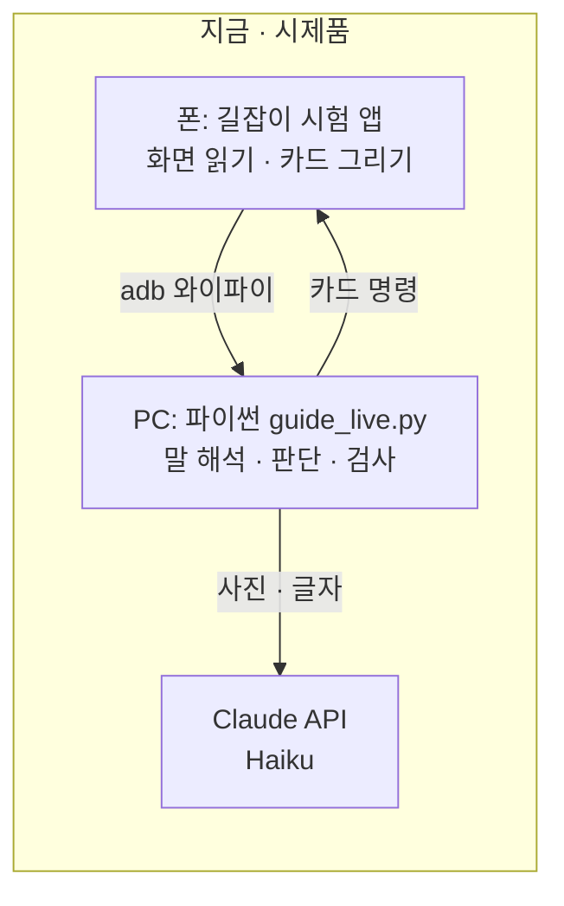
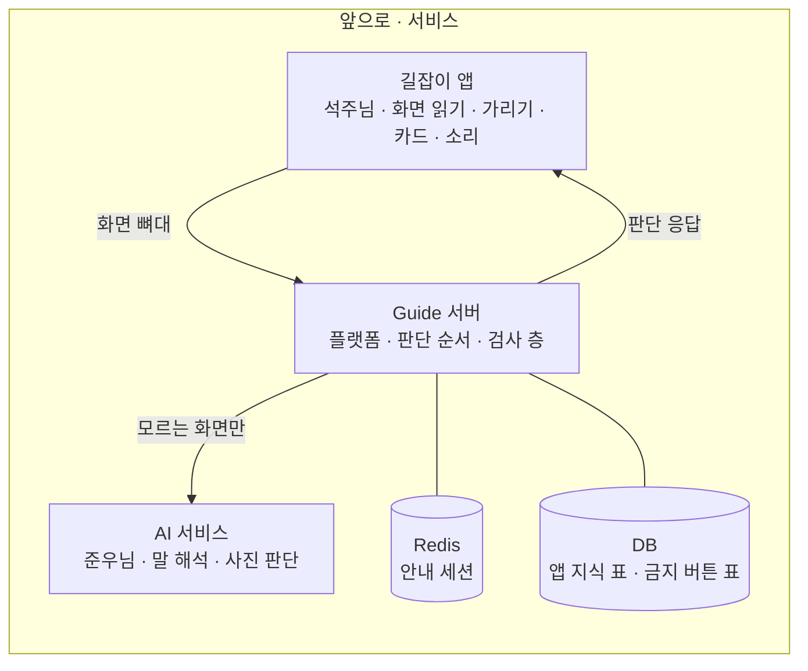
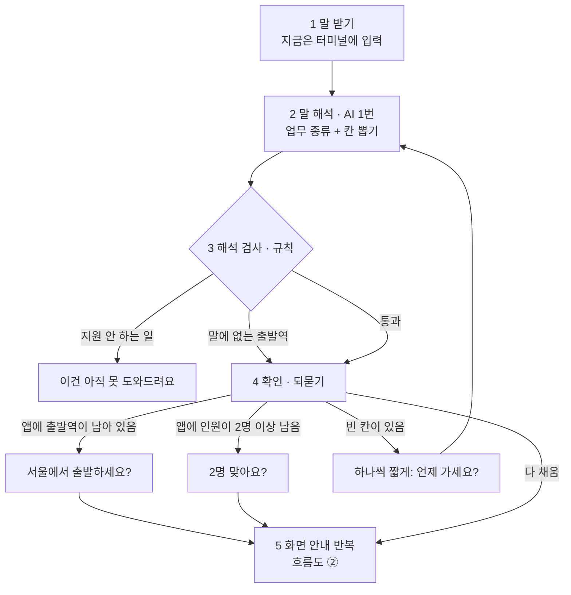
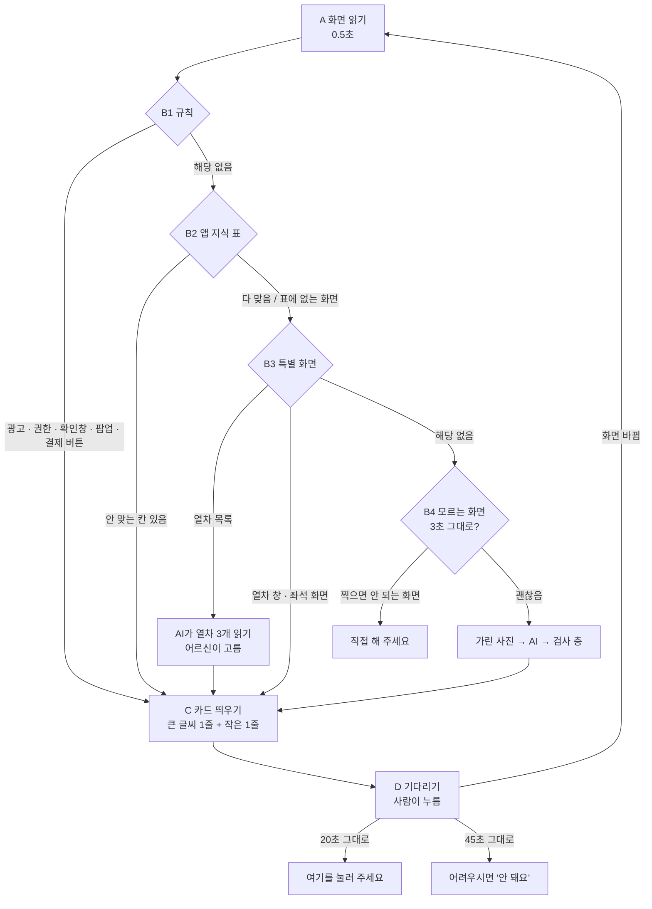

# 길잡이 시제품 · 지금 구조와 흐름, 앞으로 고칠 방향 (11/25, 김우석)

> 어제 밤부터 오늘까지 코레일+로 「말 한마디 → 예매 직전까지」 안내를 실제 폰(갤럭시 S21+)에서 돌려 봤어요. 이 문서는 **지금 코드가 어떻게 돌아가는지**와 **써 보면서 터진 문제**, **고칠 방향**을 모은 거예요.
> 목적은 하나예요. **다 같이 보고 로직을 어떻게 짤지 의견을 내 주세요.** 맨 아래 「같이 정할 것」에 번호를 달아 뒀으니 번호로 댓글 주시면 돼요.
> 그림은 GitHub에서 열면 보여요(mermaid). 디스코드나 메모장에선 그림 대신 코드 글자가 보이는데, 바로 아래 글 설명만 읽어도 돼요.

---

## 0. 한 줄 요약
- 지금은 **PC의 파이썬 시제품**이 폰 화면을 읽고, 판단하고, **폰에 깔린 시험 앱이 동그라미와 카드만** 그려요. 서버 · 실제 앱은 아직 없어요.
- 판단은 **규칙 → 앱 지식 표 → (특별 화면) → AI** 순서예요. 아는 화면은 AI 없이, 모르는 화면만 AI에게 물어요.
- **어르신이 직접 누르고**, 도구는 화면이 바뀔 때마다 다시 읽어 다음 안내를 띄워요.
- 코레일은 **「좌석 선택」까지 안내하고 「예매」 앞에서 끊어요.** 결제 · 로그인 · 인증은 안내하지 않아요.

## 1. 지금 구성 (시제품) vs 앞으로 구성 (서비스)





**글로 보면**
| | 지금 (시제품) | 앞으로 (서비스) |
|---|---|---|
| 화면 읽기 | 폰 시험 앱이 접근성으로 읽음 → adb로 PC에 전달 | 길잡이 앱이 읽어서 서버로 보냄 |
| 개인정보 가리기 | PC에서 글자 패턴으로(한계 있음) | **폰 안에서 먼저**(ML Kit), 서버는 2차 검사 |
| 판단 | PC 파이썬 한 파일 | Guide 서버(Spring), 규칙 · 앱 지식 표는 DB |
| AI | PC가 Claude 바로 부름 | AI 서비스 경유, 모델은 바꿔 끼울 수 있게 |
| 카드 · 소리 | 시험 앱이 카드만(소리 없음) | 길잡이 앱이 카드 + 소리(TTS) |
| 안내 상태 기억 | 파이썬 변수 | Redis 세션 |

## 2. 흐름도 ① 말 한마디 → 안내 시작



| 번호 | 지금 규칙 | 코드 |
|---|---|---|
| 1 | 지금은 터미널 입력, 앞으로 음성 · 버튼 | `guide_live.main` |
| 2 | AI(Haiku)가 `taskType` · `slots` · `missing`을 JSON으로 | `ai.call` + `intent_test`의 프롬프트 |
| 3 | 지원 안 하는 일이면 멈춤 / 말에 없는 **출발역**은 버림(AI가 지어냄) / 업무마다 꼭 필요한 칸만(기차 = 출발 · 도착 · 날짜) / 「부싼 → 부산」 같은 고침은 살림 | `guide_live.main` |
| 4 | 열린 질문 대신 **확인형**(앱에 남은 값 활용) / 빈 칸은 **한 번에 하나** | `guide_live.main` |
| (정규화) | 「서울역 → 서울」, 「모레 → 11월 27일 (금)」, 「찜닭 → 찜·탕」 같은 **앱 표기**로 바꿈 | `normalize.to_app` |

## 3. 흐름도 ② 화면마다 도는 안내 루프



| 번호 | 지금 규칙 | 코드 |
|---|---|---|
| A | 폰 시험 앱(접근성)이 화면 글자 · 칸 위치를 로그로 → PC가 읽음. 0.5초 | `phone.dump_fast` |
| B1 규칙 | 광고 재생 → 기다림 / 권한 · 동의 · 「네/아니오」 → 어르신이 고름 / 화면 아래 「결제하기 · 주문하기 · 예매하기」 → 멈춤 / 홍보 팝업 → 닫기 | `guide_sim.screen_type`, `RULE_REPLY` |
| B2 앱 지식 표 | 앱마다 「채울 칸 순서」를 위에서부터 보고 **처음으로 안 맞는 칸**의 버튼 안내. 맞으면 건너뜀, 앞 칸이 틀리면 뒤로 안 넘어감 | `guide_sim.KNOW`, `knowledge` |
| B3 특별 화면 | 열차 목록 → AI가 사진을 읽고 **출발 · 도착이 맞는 열차 3개를 읽어 주기만**(고르지 않음) / 열차 창 → 「좌석 선택」 / 좌석 화면 → 어르신이 고름 → 다 고르면 **「예매」 앞에서 끊음** | `train_choice`, `decide` |
| B4 모르는 화면 | 3초 그대로이고, 찍어도 되는 화면이면 → 가린 사진을 AI에 → **검사 층을 통과한 답만** 안내. 같은 화면은 다시 안 물음, 한 번 안내에 AI 최대 8번 | `ai_next`, `capture_block_reason` |
| 검사 층 | AI가 준 좌표의 **실제 칸 글자**로 금지 버튼 검사(AI가 「왼쪽 큰 버튼」이라 해도 칸 글자 「간편 예매」로 막힘), 위치 확인 못 하면 강조 안 함 | `validate2` |
| 찍으면 안 되는 화면 | 허용 앱이 아님, 권한 · 동의 · 결제 직전, 비밀번호 칸, 인증번호 · 카드번호 글자, 로그인 화면 | `guide_sim.capture_block_reason` |
| C 카드 | 동그라미 + 큰 글씨 한 줄 + 작은 글씨 한 줄. 긴 말은 「소리로 읽을 말」로 따로(지금은 터미널에만 출력) | `show` |
| D 기다리기 | 0.5초마다 다시 읽어 판단. 같으면 4초마다 카드 다시 띄움(시험 앱이 누를 때 카드를 지워서). 새 안내는 0.5초 뒤 한 번 더 확인하고 띄움 | `human_loop` |

## 4. 코드 지도 (어디에 뭐가 있나)

**PC 시제품** 백엔드 저장소 PR #2의 `prototype/guide-night-1125/` (11/25 오후까지 고친 것 포함. 이 문서도 같은 폴더의 `구조와_흐름_1125.md`)
| 파일 | 하는 일 | 서비스에선 누가 | 크기 |
|---|---|---|---|
| `guide_live.py` | 말 해석 → 확인 · 되묻기 → 화면 루프(`human_loop`) · 열차 읽기 · 모르는 화면 AI · 카드 | **서버**(판단 순서) + **앱**(카드 · 기다리기) | 519줄 |
| `guide_sim.py` | 화면 종류 규칙(`screen_type`), **앱 지식 표(`KNOW`)**와 판단(`knowledge`), 찍으면 안 되는 화면 | **서버**(규칙 · 표는 DB로) | 351줄 |
| `validate2.py` | AI 답 검사 층 | **서버** | 99줄 |
| `mask.py` | 개인정보 글자 패턴 · 사진 가리기 | **앱**(1차) + **서버**(2차) | 52줄 |
| `normalize.py` | 말 → 앱 표기(역 이름 · 날짜 · 음식 카테고리) | **서버** | 31줄 |
| `phone.py` | 폰 읽기(`dump_fast`) · 안전 누르기 · 금지 단어 | 시험 도구(서비스엔 안 옮김) | 276줄 |
| `ai.py`, `eval_v2.py`, `intent_test.py` | Claude 부르기 · 비용 기록 · 프롬프트 | **AI 서비스** | |
| `regress.py`, `validate_regress.py` | 회귀 시험(화면 → 기대 행동 34개, AI 답 → 막을지 22개) | **서버 테스트** | |

**폰 시험 앱** `android_guide_app/` (Java, 우리 진짜 앱 아님)
| 명령 | 하는 일 |
|---|---|
| `SHOW` | 좌표에 동그라미 + 카드(say · sub) |
| `STOP` | 카드 지우기 |
| `DUMP2` | 접근성으로 지금 화면 글자 · 칸 위치를 로그로 |
| `STREAM` | 화면이 0.4초 멈추면 알아서 보냄 (아직 안 씀, 속도 개선에 쓸 것) |

**앱 지식 표 생김새** (`guide_sim.KNOW`, 앞으로 DB 「앱 지식」 표)
```
코레일+ (com.korail.talk)
  시작 화면 표시: 「어디로 떠나볼까요?」
  칸 순서:
    DEPARTURE  열기 「출발역선택」, 고르기 「{DEPARTURE}」, 확인 「출발역 {DEPARTURE} 선택됨」, 목록에 없으면 초성 탭
    ARRIVAL    (위와 같음)
    DATE       열기 「가는날」, 고르기 「{DATE}」, 확정 「선택 완료」, 다른 달이면 「이전달 · 다음달」
    COUNT      말했을 때만, 「어른 · 경로 · 어린이 인원증가 · 감소」로 맞춤
    SEARCH     「열차 조회」
```
약속(서버 ↔ 앱 ↔ AI 주고받는 모양)은 백엔드 저장소 PR #4 `docs/contract-v0.1.md`에 있어요.

## 5. 직접 써 보며 터진 문제 (오늘)
| 문제 | 원인 | 지금 상태 |
|---|---|---|
| 너무 느림 | 화면 읽기가 2.5 ~ 10초(시험 도구 uiautomator) | 시험 앱 접근성 읽기로 0.5초. **그래도 한 화면 1 ~ 2초, AI가 나서면 6 ~ 10초** |
| 안내가 빨리 사라짐 | 시험 앱이 누르는 순간 카드를 「잘하셨어요」로 바꿈 | 4초마다 다시 띄우는 땜질. **앱에서 고칠 일** |
| 26일만 누르고 「선택 완료」 안내가 안 옴 | 화면이 넘어가는 중에 판단하고 끝냄 | 계속 다시 읽기로 고침 |
| 화면 넘어갈 때 「뒤로 누르세요」가 잠깐 뜸 | 덜 그려진 화면으로 판단 | 0.5초 뒤 한 번 더 확인하고 띄움 |
| 「모레」라고만 했는데 지난번 2명 그대로 | 앱에 남은 값을 안 따짐 | 「2명 맞아요?」 확인 |
| 열차를 고른 뒤 다음 안내 없음 | 열차 창 · 좌석 화면을 몰랐음 | 「좌석 선택」 → 어르신이 자리 고름 → 「예매」 앞 끊음 |
| AI가 혼자 「새벽 5시 3분 열차 누르세요」 | AI에게 「누를 곳 하나」를 물어서 | 열차는 읽어 주고 어르신이 고르게 |
| 사진 찍는 순간 알림창이 덮어 알림 내용이 AI로 | 찍은 뒤 화면 확인을 안 함 | 화면이 바뀌었으면 결과 버림. **근본은 폰 안 가리기** |
| 시트 뒤로 비친 집 주소가 AI로(어젯밤) | 글자 목록에 없는 글자는 서버에서 못 가림 | **폰 안 가리기 필요(앱)** |

자세한 기록: `시나리오별_문제점_1125.md`(시나리오 0 ~ 3), `시나리오3_코레일_개선_1125.md`(코레일 전후)

## 6. 문제를 층으로 나눠 보면 (앞으로 구조의 기준)
지금까지 터진 문제 대부분은 **앱마다 다른 게 아니라 공통**이었어요. 그래서 로직도 층으로 나누면 새 앱을 붙일 때 앱 지식 표만 채우면 돼요.

| 층 | 예 | 어디서 처리 |
|---|---|---|
| ① 모든 앱 공통 | 앱이 지난 화면에서 열림, 화면 넘어가는 중, 카드가 가림, 알림이 덮음, 화면 못 읽음, 안 누르면 다시 안내, 결제 앞 멈춤, AI는 고르지 않기 | 서버 공통 규칙 + 앱 |
| ② 화면 부품 공통 | 달력(달 넘기기), 인원 +/−, 목록에서 고르기(읽어 주고 묻기), 장소 고르기(초성 · 검색), 팝업 닫기 | 서버 「부품」 규칙, 앱마다 이름만 다름 |
| ③ 앱마다 다른 것 | 칸 순서, 버튼 이름, 시작 화면 표시, 끊는 지점(코레일 「예매」, 배민 「담기」) | 앱 지식 표(DB) |
| ④ 모르는 화면 | 처음 보는 앱 · 바뀐 화면 | AI + 검사 층 |

## 7. 고칠 방향 (제안, 같이 정해요)
1. **속도**: PC가 0.4초마다 묻는 방식 → **폰이 화면이 바뀌면 알려 주는 방식**(시험 앱의 STREAM, 실제 앱도 같은 방식). AI 답을 짧게(열차 목록 6초 → 2초), 다음 화면을 미리 읽기
2. **카드가 사라지지 않게**: 앱이 「누름 확인」은 작게, 다음 안내가 올 때까지 카드 유지
3. **잘못 누름 알기**: 앱이 실제로 누른 버튼 이름(`clickedLabel`)을 보내면 「다른 걸 누르셨어요」가 가능
4. **개인정보**: 사진은 폰 안에서 먼저 가림(주소 · 전화 · 이름 · 상태 표시줄 · 알림)
5. **규칙 · 앱 지식 표를 코드에서 데이터로**: 지금은 파이썬에 박혀 있음 → DB 표 + 관리 웹에서 고치기, 화면 부품(달력 · 인원 · 목록)은 공통 규칙으로
6. **소리**: 카드는 짧게, 긴 말은 소리로(서버는 `say` · `sub` · `speak` 세 칸을 내려 줌)
7. **끊는 지점 표준화**: 업무마다 「여기부터는 직접」 지점과 그다음(가족 연결 등)

## 8. 같이 정할 것 (번호로 의견 주세요)
| # | 질문 | 누구와 |
|---|---|---|
| Q1 | 카드는 「큰 글씨 1줄 + 작은 1줄」 + 소리로 갈까요? 위치는 동그라미 옆 말풍선 vs 화면 위 고정 띠? | 앱 · 기획 |
| Q2 | 누른 순간 피드백(「잘하셨어요」)과 다음 안내 사이를 어떻게 이을까요? | 앱 |
| Q3 | 앱에 남아 있는 값(지난번 출발역 · 인원 · 날짜)을 어디까지 믿고, 어디서 확인할까요? | 기획 |
| Q4 | 시간을 말 안 하면 먼저 물을까요, 지금 이후 열차부터 보여 줄까요? 경로(65세 이상) 할인은 처음에 확인할까요? | 기획 |
| Q5 | 모르는 화면에서 AI 안내가 틀리면 어떻게 돌아올까요(「안 돼요」 → 다시 묻기? 사람에게?) | AI · 기획 |
| Q6 | 「예매」 앞에서 끊은 다음은? 그냥 끝 / 가족에게 이어 하기 / 다음에 이어서 | 기획 |
| Q7 | 판단 순서(규칙 → 앱 지식 → 특별 화면 → AI)를 서버에 둘지, 일부(규칙 · 화면 부품)를 앱에 둘지(속도 때문에) | 앱 · 플랫폼 |
| Q8 | 앱 지식 표를 누가 어떻게 채울까요(사람이 관리 웹에서 / 성공한 길을 쌓아서 / AI가 초안) | 전체 |

의견은 이 문서가 올라간 PR에 줄 댓글로 주시거나, 워크스페이스 결정 로그에 「Q번호」로 올려 주세요.

## 9. 직접 돌려 보기
**폰 없이** (파이썬 3.11+, `pip install pillow`): 백엔드 저장소 `prototype/guide-night-1125/`에서
```
python -I regress.py            # 34개, 화면 → 기대 행동
python -I validate_regress.py   # 22개, AI 답 검사 · 찍으면 안 되는 화면
```
**폰으로** (안드로이드 + 길잡이 시험 앱 설치 + 무선 디버깅 + Claude API 키 필요, 지금은 우석 폰 기준)
```
PHONE_DEV=<폰 주소> GUIDE_HUMAN=1 python guide_live.py korail 40
```
터미널에 어르신 말을 치고, 폰에서 직접 누르면 돼요. 「예매」 · 결제 · 로그인은 누르지 마세요.

## 10. 주의
- GitHub 저장소는 **Public**이에요. 폰 캡처 · 화면 덤프 · 로그는 올리지 마세요(주소 · 이름이 보여요). 시험 화면이 필요하면 PR #2의 `fixtures/`(개인정보 지운 사본)를 쓰세요.
- 시제품 코드는 대부분 Claude로 만들었고 우석이 같이 읽으며 고쳤어요. 서비스 코드로 옮길 때는 구조만 참고하고 새로 짜는 게 맞아요.
